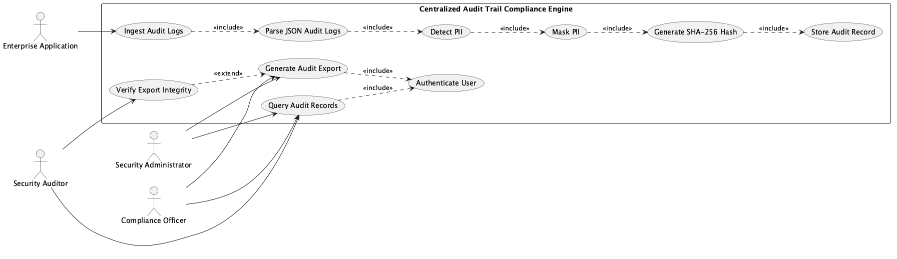

# Lab 1: Centralized Audit Trail Compliance Engine

**Course:** Software Engineering (SE)  
**Topic:** Requirements Engineering, UML Use Case Modeling & Specification  

---

## 1. Overview

The **Centralized Audit Trail Compliance Engine** is designed to ingest, process, protect, and store enterprise audit logs in a centralized, tamper-evident repository. It automates PII detection and masking to maintain regulatory compliance (such as GDPR) while guaranteeing data immutability with cryptographic SHA-256 integrity hashing.

---

## 2. Deliverables & Documentation

- [requirements.md](requirements.md) — Complete Functional (FR-001 to FR-005) and Non-Functional (NFR-001, NFR-002) Requirements specification with priorities and acceptance criteria.
- [use-case-flow.md](use-case-flow.md) — Detailed Use-Case Flow specification for *UC-001: Ingest Audit Logs* (preconditions, postconditions, main success scenario, and alternative error handling flows).
- [use-case-diagram.puml](use-case-diagram.puml) — PlantUML source code for the system use case diagram.
- [use-case-diagram.png](use-case-diagram.png) — Rendered UML use case diagram.

---

## 3. Use Case Diagram

---

## 4. Key Functional Capabilities

1. **Structured Log Ingestion & Parsing:** Ingests JSON audit records from multiple enterprise applications.
2. **Automated PII Identification & Masking:** Detects sensitive attributes (SSN, emails, credit cards) and masks them according to compliance rules.
3. **Cryptographic Integrity Hashing:** Generates and attaches SHA-256 integrity hashes to each audit record.
4. **Immutable Audit Storage & Querying:** Stores processed logs in an append-only store with sub-second querying across large audit datasets.
5. **Verifiable Audit Exports:** Produces cryptographically verifiable compliance reports for external regulators.
